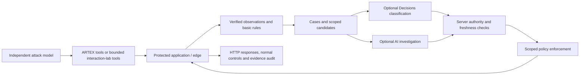

# Defense layers and the attack simulator

Reverse Artex is built for defense of applications you own or are authorized to assess. ARTEX simulations run against owned synthetic fixtures to evaluate prevention, response and recovery.

Reverse Artex separates observations, decisions and enforcement. The basic launch is loopback-bound and observation-only. Optional components need explicit configuration; starting the console does not enable all three defense layers.

## 1. Basic defense

The collector validates authenticated normalized events, retains evidence and runs deterministic detection rules. Application authorization requires the separately integrated SDK, session identity, object ACL snapshots, registered routes and private upstream boundary. Registered-edge protection verifies the SDK proof and response body before release. Optional native policies have their own fixed eligibility, scope, lifetime and owner rules.

Rule alerts alone are not instructions to mutate policies. SDK denials and model-selected temporary restrictions have different causes; a model restriction on an already SDK-denied read does not demonstrate additional data protection.

## 2. Decisions assistance

The optional Decisions provider classifies a bounded, pseudonymized case view. `off` makes no provider calls. Shadow/advisory modes record classifications without applying policies. Enforce-gated mode additionally requires an explicitly configured calibration gate, typed valid results, thresholds and an eligible current server-created candidate. A classification score cannot broaden scope or clear mandatory review.

Remote API availability, classification quality and local enforcement are measured separately. A mock provider test is not a live API test. See [Decisions contract](V2-DECISIONS.md).

## 3. AI model investigation and response

An explicitly enabled model can read offered evidence and select offered investigation or response tools. The server validates references, case revision, scope, owner, freshness and deadline before any mutation. Invalid model arguments, stale evidence or an expired run cannot authorize an action. An installation acknowledgment is not evidence of actual HTTP blocking; a successful release must be checked against normal traffic and the original request.

Tool-capable native model calls and a strict text-JSON compatibility adapter are different interfaces. Test reports name the actual transport and model. Unsupported native tools are not silently treated as supported. See [local investigation](LOCAL-QWEN.md) and [v2 response observations](V2-L3-OUTCOMES.md).

The optional `grounded_assessment` setting is disabled by default. It requires bundled context, prefetched observations and short references, and cannot be combined with containment. In analyze-only runs, the server computes observation ages and the admissible assessment classes from the sampled signed evidence. It rejects unsupported classes and citations, and rechecks freshness at durable commitment. It preserves the model's original text; it does not make that text authoritative or establish autonomous response quality.

## Independent attack role and simulation boundaries

An attacker uses a separate conversation, history, prompt and tool permissions from the defender. The actual ARTEX Engine/Planner/Worker execution path and the interaction lab's bounded direct-tool driver are distinct test modes; reports must name which ran. Sharing local model weights does not mean sharing conversation history or providing OS process isolation.

All current release simulations target owned loopback services and synthetic tenants/resources. They do not authorize external targets. Count actual unauthorized payloads, pre-existing SDK/app denials, policy denials, legitimate requests, deliberate faults, explicit release and recovery separately. Preserve failed attempts and frozen test inputs. General attack prevention, model quality and production capacity require broader evaluation.

## 한국어 요약

- **기본 방어:** 인증된 관측·규칙 탐지와, 별도 연동한 SDK·세션·ACL·등록 edge의 권한 검사 및 집행입니다.
- **Decisions 보조:** 제한된 사건 문맥을 분류합니다. 기본 off이고 advisory는 정책을 바꾸지 않습니다. 자동 집행에는 별도 교정·적격 후보·현재 상태 검증이 필요합니다.
- **AI 모델 방어:** 증거를 조사하고 허용된 제한·해제 도구를 선택합니다. 실제 권한·범위·기한·owner 검증은 서버가 담당합니다.
- **공격 모델:** 방어와 독립된 대화에서 ARTEX 또는 제한된 랩 도구를 사용합니다. 두 실행 방식을 같은 성능 결과로 합치지 않습니다.
- 기본 실행은 관측 모드입니다. 소유한 합성 앱 시험의 성공을 일반 운영 환경의 방어 보장으로 확대하지 않습니다.
